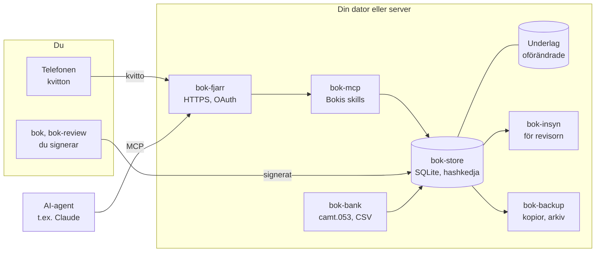

<p align="center">
  
</p>

<h1 align="center">Bokis</h1>

<p align="center"><strong>SaaS-döden för bokföring.</strong><br>
Bokför själv, gratis och AI-first, på din egen dator.</p>

## Sluta betala för att få bokföra

Bokföringstjänsterna i molnet tar betalt varje månad: för bokföringen, banken, fakturorna och varje
ny användare. Bokis är ett gratis alternativ till Fortnox, Visma och de andra prenumerationerna, och
du behöver ingen konsult för den löpande bokföringen.

- **Gratis.** Öppen källkod under MIT. Ingen licens och ingen månadsavgift.
- **AI-first.** En AI-agent läser kvitton och fakturor, föreslår konteringar, stämmer av banken och
  frågar när något är oklart. Den använder din egen AI-tjänst, till exempel Claude.
- **Du bestämmer.** Agenten kan bara föreslå. Varje verifikation signeras av dig, gärna med en
  YubiKey.
- **Din data.** Bokföringen och alla underlag ligger på din dator eller server.

## Så fungerar det

1. Du fotar kvittot med telefonen eller lägger fakturan i inkorgen. Kontoutdrag läses in som
   camt.053 eller CSV, till exempel från Lunar.
2. Agenten läser underlaget och föreslår en verifikation, eller frågar dig.
3. Du granskar och signerar. Först då får verifikationen sitt nummer.
4. Det bokförda går inte att ändra. Fel rättas med en ny verifikation, och allt syns i historiken.
5. Revisorn och Skatteverket får hela bokföringen som läsbara sidor, live eller som export.



Agenten och telefonen når Bokis bara genom `bok-fjarr`, som släpper fram agentens verktyg och
telefonens uppladdning. Allt som kräver din nyckel gör du själv med `bok`.

## Bokis skills

Agenten arbetar genom tolv verktyg över MCP. Claude, ChatGPT och lokala modeller kan ansluta.

| Skill | Vad agenten gör |
|-------|-----------------|
| `lista_underlag` | Listar nya kvitton och fakturor i inkorgen |
| `hamta_underlag` | Läser ett underlag; bilder skalas ner, originalet ligger kvar orört |
| `hamta_kontoplan` | Läser kontoplanen |
| `hamta_regler` | Läser reglerna den ska följa: moms, representation, gåvor med mera |
| `sok_motpart` | Ser hur samma motpart har konterats tidigare |
| `lista_omatchade_bankrader` | Ser bankrader som inte är avstämda |
| `foresla_verifikation` | Lägger ett förslag till verifikation |
| `foresla_matchning` | Föreslår vilken verifikation en bankrad hör till |
| `stall_fraga` | Frågar dig när underlaget inte räcker |
| `flagga_underlag` | Flaggar dubbletter, privata kvitton och underlag som saknar uppgifter |
| `lista_inventarier` | Läser inventarieregistret med bokfört värde enligt plan |
| `foresla_avskrivningar` | Föreslår årets avskrivningar; Bokis räknar beloppen |

Reglerna som agenten följer signerar du själv in. Grundreglerna, med lagrum och källor, finns i
[`docs/regler`](docs/regler/).

## Lagar och krav

| Krav | Lagrum | Läge |
|------|--------|------|
| Verifikation för varje affärshändelse, med datum, innehåll, belopp och motpart | BFL 5 kap. 6–8 §§ | Uppfyllt |
| Obruten verifikationsserie | BFNAR 2013:2 p. 5.9 | Uppfyllt |
| Det bokförda går inte att radera eller ändra | BFL 5 kap. 5 §, BFNAR 2013:2 p. 2.1 | Uppfyllt |
| Rättelse med rättelsepost i rätt period | BFL 5 kap. 5 §, BFNAR 2013:2 p. 2.17 | Uppfyllt |
| Grundbok, huvudbok och behandlingshistorik | BFL 5 kap. 1 och 11 §§ | Uppfyllt |
| Systemdokumentation | BFL 5 kap. 11 § | Delvis: arkivplan saknas |
| Förvaring i sju år, i Sverige | BFL 7 kap. 2 § | Bokis stödjer, du väljer platsen |
| Momsdeklarationens fält | Skatteverkets fält 05–62 | Uppfyllt för konton med momskod, även vinstmarginalbeskattning (07) och trepartshandel (37–38) |
| Momsavdrag bara mot faktura eller kvitto | ML 13 kap. 31–32 §§ | Uppfyllt med grundreglerna |
| Representation, gåvor och privata kostnader | ML 13 kap. 24–25 §§, IL 9 kap. 2 §, 16 kap. 2 § | Uppfyllt med grundreglerna |
| Avskrivning enligt plan och inventarier av mindre värde | ÅRL 4 kap. 4 §, K2 kap. 10, IL 18 kap. 4 § | Uppfyllt: inventarieregistret, förslag om årets avskrivningar |
| Periodisering, med K2:s gräns 7 000 kr | ÅRL 2 kap. 4 §, K2 p. 2.4 | Uppfyllt: förslag med återföring |
| Bolagsskatt och inkomstdeklaration 2 | IL 1 kap. 7 §, 65 kap. 10 §, Skatteverkets SRU-format | Uppfyllt: INK2, INK2R och INK2S som SRU-filer |
| Årsredovisning | Årsredovisningslagen | Ingår inte än |

Hela kartläggningen med källor finns i [`docs/lagkontroll.md`](docs/lagkontroll.md). Bokis är ett
verktyg: ansvaret för bokföringen ligger kvar hos företaget.

## Kom igång

```bash
cargo build --release -p bok-cli -p bok-mcp -p bok-review
export PATH="$PWD/target/release:$PATH"
ssh-keygen -t ed25519-sk                          # din nyckel, på en YubiKey
bok init --company "Exempel AB" --orgnr 556000-0001 --year 2026
bok konto importera kontoplan.se                  # din kontoplan, till exempel ur en SIE-fil
bok inkorg ~/Kvitton                              # kvitton och fakturor in
claude mcp add bokis -- "$PWD/target/release/bok-mcp" --db ~/.local/share/bokis/bokis.db
bok-review --db ~/.local/share/bokis/bokis.db     # granska och signera agentens förslag
bok verify                                        # kontrollera hela bokföringen
```

Vill du hellre signera med en nyckelfil än med en YubiKey väljer du det med
`bok init --security mjukvara`.

## Läs mer

- [Använda Bokis](docs/anvandning.md): alla kommandon, säkerhetsnivåer, bank, moms, bokslut,
  inventarier och inkomstdeklarationen (INK2 som SRU-filer)
- [Bokis på distans](docs/distans.md): agenten i mobilen, kvittofoton och Bokis på en Raspberry Pi
- [Insyn för revisor och Skatteverket](docs/insyn.md)
- [Lagkontrollen](docs/lagkontroll.md) och [agentmätningen](docs/agentmatning-2026-11-14.md)
- [Utveckling](docs/utveckling.md): crates, schema och granskningar
- [Skrivbordsappen](docs/skrivbordsappen.md), den första versionen av Bokis

## Licens

MIT, se [LICENSE](LICENSE).
