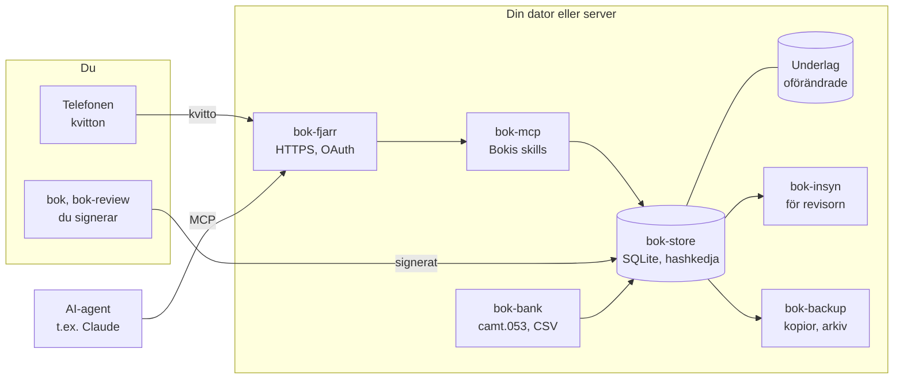

<p align="center">
  
</p>

<h1 align="center">Bokis</h1>

<p align="center"><strong>SaaS-döden för bokföring.</strong><br>
Bokför själv, gratis och AI-first, på din egen dator.</p>

## Sluta betala för att få bokföra

Bokföringstjänsterna i molnet tar betalt varje månad: för bokföringen, för fakturorna, för banken,
för varje användare och för varje ny funktion. Bokis är ett alternativ till Fortnox, Visma och de
andra prenumerationerna. Programmet är gratis och öppen källkod, och bokföringen ligger hos dig.

Du behöver inte heller betala en konsult för den löpande bokföringen. En AI-agent läser kvitton och
fakturor, föreslår konteringar, stämmer av banken och frågar när något är oklart. Du granskar och
godkänner. Inget bokförs utan dig.

- **Gratis.** Ingen licens, ingen månadsavgift, inga moduler. AI-agenten använder din egen
  AI-tjänst, till exempel Claude.
- **AI-first.** Agenten föreslår, frågar och flaggar. Den kan aldrig bokföra själv.
- **Du signerar.** Varje verifikation godkänns av en människa med en nyckel, gärna en YubiKey. Du
  väljer säkerhetsnivån.
- **Din data.** Databasen och alla underlag ligger på din dator eller server, i Sverige.
- **Kvitton från telefonen.** Fota kvittot och ladda upp det med en personlig länk.
- **Banken in.** Kontoutdrag som camt.053 eller CSV, till exempel från Lunar Business.
- **Kontrollerad mot lagen.** Bokföringslagen, BFN:s regler och momslagen, med källor.
- **Insyn för revisor och Skatteverket.** Hela bokföringen som läsbara sidor, live eller som
  fristående export.

## Bokis skills

Agenten får sina förmågor från Bokis, som verktyg över MCP. Claude, ChatGPT och lokala modeller
kan ansluta. Agenten kan läsa och föreslå, aldrig bokföra.

| Skill | Vad agenten gör |
|-------|-----------------|
| `lista_underlag` | Listar nya kvitton och fakturor i inkorgen |
| `hamta_underlag` | Läser ett underlag; bilder skalas ner, originalet ligger kvar orört |
| `hamta_kontoplan` | Läser kontoplanen |
| `hamta_regler` | Läser reglerna den ska följa: moms, representation, gåvor med mera |
| `sok_motpart` | Ser hur samma motpart har konterats tidigare |
| `lista_omatchade_bankrader` | Ser bankrader som inte är avstämda |
| `foresla_verifikation` | Lägger ett förslag till verifikation |
| `foresla_matchning` | Föreslår vilken verifikation en bankrad hör till |
| `stall_fraga` | Frågar dig när underlaget inte räcker |
| `flagga_underlag` | Flaggar dubbletter, privata kvitton och underlag som saknar uppgifter |

Reglerna är data som du signerar in, med lagrum och källa. Grundreglerna finns i
[`docs/regler`](docs/regler/).

## Så hänger det ihop



Agenten och telefonen når Bokis genom `bok-fjarr`, som bara släpper fram agentens verktyg och
telefonens uppladdning. Allt annat gör du själv med `bok`: bokföra, stänga perioder, ändra regler
och ta kopior. Det kräver din nyckel.

## Lagar och krav

| Krav | Lagrum | Läge |
|------|--------|------|
| Verifikation för varje affärshändelse, med datum, innehåll, belopp och motpart | BFL 5 kap. 6–8 §§ | Uppfyllt |
| Obruten verifikationsserie | BFNAR 2013:2 p. 5.9 | Uppfyllt |
| Det bokförda går inte att radera eller ändra | BFL 5 kap. 5 §, BFNAR 2013:2 p. 2.1 | Uppfyllt |
| Rättelse med rättelsepost i rätt period | BFL 5 kap. 5 §, BFNAR 2013:2 p. 2.17 | Uppfyllt |
| Grundbok, huvudbok och behandlingshistorik | BFL 5 kap. 1 och 11 §§ | Uppfyllt |
| Systemdokumentation | BFL 5 kap. 11 § | Delvis: arkivplan saknas |
| Förvaring i sju år, i Sverige | BFL 7 kap. 2 § | Bokis stödjer, du väljer platsen |
| Momsdeklarationens fält | Skatteverkets fält 05–62 | Uppfyllt, utom vinstmarginalbeskattning och trepartshandel |
| Momsavdrag bara mot faktura eller kvitto | ML 13 kap. 31–32 §§ | Uppfyllt med grundreglerna |
| Representation, gåvor och privata kostnader | ML 13 kap. 24–25 §§, IL 9 kap. 2 §, 16 kap. 2 § | Uppfyllt med grundreglerna |
| Årsredovisning | Årsredovisningslagen | Ingår inte |

Hela kartläggningen, med källor, finns i [`docs/lagkontroll.md`](docs/lagkontroll.md). Bokis är
ett verktyg. Ansvaret för bokföringen ligger kvar hos företaget, som också lämnar deklarationer och
årsredovisning.

## `bok` – bokföra från kommandoraden (milstolpe 1)

`bok` är verktyget för den som granskar och bokför. Ett förslag får inget verifikationsnummer;
numret tas ur serien först när du godkänner, och varje bokföring signeras med din nyckel
(`ssh-keygen -Y sign`, helst en YubiKey med en `ed25519-sk`-nyckel). Ett avvisat förslag
förbrukar inget nummer. Bokförda verifikationer, rader, underlag och historiken kan inte ändras
eller raderas; databasen själv vägrar. Fel rättas med en ny verifikation i serie R.

```bash
cargo build --release -p bok-cli          # ger target/release/bok
ssh-keygen -t ed25519-sk                  # en gång: nyckel på YubiKeyn, ger ~/.ssh/id_ed25519_sk
```

Databasen ligger i `~/.local/share/bokis/bokis.db` och underlagen i katalogen `underlag/` bredvid.
Ange annan plats med `--db` eller `BOKIS_DB`, och annan nyckel med `--key` eller `BOKIS_KEY`.

```bash
# Ny bokföring: företaget, din nyckel och första räkenskapsåret (A, B, I och R börjar på 1)
bok init --company "Vetra AB" --orgnr 559000-0000 --year 2026
bok account import kontoplan.se           # #KONTO ur en SIE-fil, eller KONTO;NAMN per rad

# Underlag och förslag
bok attachment add kvitto.pdf             # sparas oförändrat med SHA-256 och mottagningstid
bok propose --date 2026-03-15 --text "Papper" --line 5410=80,00 --line 2641=20,00 \
    --line 1930=-100,00 --attachment 1 --counterparty-name "Papper AB" --orgnr 556000-0000
bok proposals                             # förslag som väntar på beslut
bok approve 1                             # bokför som nästa nummer i serien; rör vid nyckeln
bok reject 2 --reason "dubblett"

# Rättelse: ny verifikation i serie R som tar ut originalet (och lägger till rätt rader)
bok correct A1 --reason "fel konto" --line 6110=80,00 --line 1930=-80,00 --approve

# Perioder: öppen → under avstämning → stängd → låst. Stängd och låst öppnas aldrig igen.
bok period review 2026-03 && bok period close 2026-03 && bok period lock 2026-03

# Rapporter, kontroll och export
bok journal                               # grundbok i registreringsordning
bok ledger --account 1930                 # huvudbok med ingående balans
bok trial-balance                         # saldobalans
bok show A1                               # verifikationen med signatur och hashar
bok history                               # behandlingshistoriken
bok verify                                # serier, historikens kedja, signaturer, arkivet
bok export sie --out bokis-2026.se        # SIE 4 med #IB, #UB och #RES
```

Positivt belopp i `--line` är debet och negativt kredit. Ett förslag kan också läggas som JSON
med `--file` (samma form som agenten kommer att använda). Kommandona har svenska alias:
`godkann`, `avvisa`, `ratta`, `grundbok`, `huvudbok`, `saldobalans`, `verifiera` med flera.
Det finns inga kommandon som raderar, nollställer eller återställer en databas, och `bok init`
skriver aldrig över en befintlig fil.

### Säkerhetsnivå

Bokföringslagen kräver ingen viss sorts signatur. Den kräver att det syns vem som gjorde vad och
när, och att bokföringen inte kan ändras i efterhand utan att det märks. Det klarar Bokis på alla
tre nivåerna. Nivån avgör hur svårt det är för någon annan, till exempel en AI-agent på samma
dator, att godkänna något i ditt namn.

| Nivå | Bokis godtar | Vem kan signera i ditt namn |
|------|--------------|-----------------------------|
| `mjukvara` | alla registrerade nycklar, också en nyckelfil | allt som kör som du och når nyckeln |
| `hardvara` (standard) | bara hårdvarunycklar, som måste röras vid varje signatur | bara den som rör nyckeln |
| `hardvara-pin` | som `hardvara`, och nyckelns PIN vid varje signatur | bara den som rör nyckeln och kan PIN-koden |

```bash
ssh-keygen -t ed25519-sk                       # hardvara: nyckeln på YubiKeyn
ssh-keygen -t ed25519-sk -O verify-required    # hardvara-pin: YubiKeyn kräver också PIN
ssh-keygen -t ed25519                          # mjukvara: en nyckelfil, gärna med lösenfras

bok init --security mjukvara --company "Vetra AB" --orgnr 559000-0000 --year 2026
bok sakerhet visa                              # nivån och alla beslut om den
bok sakerhet satt hardvara-pin                 # signeras; beslutet står i historiken
```

Den som höjer nivån signerar med en nyckel som klarar den nya nivån, och den som sänker den med en
nyckel som klarar den gamla. En agent eller någon som kommit åt en nyckelfil kan alltså inte sänka
nivån. Registrera en reservnyckel med `bok nyckel lagg-till` innan du höjer. Utan en nyckel som
klarar nivån går det inte att signera något alls.

På nivån `mjukvara` gör en lösenfras på nyckelfilen stor skillnad, men den syns inte i signaturen.
Bokis kan därför inte kräva den. Ha nyckeln i ssh-agent bara när du godkänner, till exempel med
`ssh-add -t 10m ~/.ssh/id_ed25519`, och peka ut den med `BOKIS_KEY`.

Bokis prövar det som signaturen visar: nyckeltypen och om nyckeln intygade beröring och PIN. Att
en hårdvarunyckel verkligen sitter i en YubiKey förutsätter att det var du som registrerade den. En
bokföring från före nivåerna har inget beslut och godtar alla registrerade nycklar tills du
beslutar en nivå.

## Inkorg, kopior, agent, granskning och bank (steg 2–4)

```bash
cargo build --release -p bok-cli -p bok-mcp -p bok-review

# Inkorg: nya filer arkiveras oförändrade, registreras och flyttas sedan till <mapp>/inlasta
bok inkorg ~/Kvitton

# Kopior till en extern plats (BFNAR 2013:2 p. 8.2), med SHA-256-manifest
bok kopia skapa /media/usb/bokis          # konsistent kopia av databasen och nya underlag
bok kopia lista /media/usb/bokis
bok kopia kontrollera /media/usb/bokis/kopior/<tid>
bok kopia las-in /media/usb/bokis/kopior/<tid> /tmp/provlasning   # bara till en tom katalog

# Bank: kontoutdraget arkiveras som underlag och raderna läses in (en gång, även om filen läses igen)
bok bank importera utdrag.xml             # camt.053; CSV med --csv-account <konto>; --account 1930
bok bank importera transactions-….csv --csv-account <kontonummer>   # Lunar Business, se nedan
bok bank rader                            # rader som inte är avstämda (--all för alla)
bok bank forslag                          # verifikationer med samma belopp, och agentens förslag
bok bank matcha 1 A12                     # stäm av rad 1 mot A12 (beloppet på 1930 måste stämma)
bok bank matcha 2 --explanation "..."     # eller med en skriftlig förklaring
# En period med bankrader som inte är avstämda kan varken stängas eller låsas.

# Moms: momskoden på kontot är rutan i momsdeklarationen, och den är data i kontoplanen.
bok konto importera kontoplan.se --vat-codes docs/momskoder-bas.txt   # KONTROLLERA filen först
bok moms 2026-03                          # eller 2026-01:2026-03, eller 2026
bok konto momskoder ändringar.txt --from 2026-07-01                   # ändringar gäller framåt

# Avstämning mot ett externt saldo, till exempel skattekontot mot Skatteverket; loggas i historiken
bok avstam 1630 --date 2026-03-31 --balance 12345,00 --note "Skattekontot mars"

# Systemdokumentation, genererad ur bokföringen: spärrarna som de står i schemat, agentens och
# granskarens operationer, nycklar, perioder, momskoder och en full verifiering. Loggas i historiken.
bok systemdokumentation systemdokumentation-2026-11.md

# Bokslut (steg 5): förslag som du granskar och bokför med nyckeln som alla andra
bok bokslut resultat --year 2026          # serie B: årets resultat från 8999 till 2099 (--equity-account 2019 för EF)
bok ar lagg-till 2027
bok bokslut ib --year 2026                # serie I i 2027: balanskontonas utgående saldon
bok arkivpaket /media/usb/arkiv --year 2026   # SIE, rapporter, underlag, historik, systemdok, programmet
                                          # kontrolleras utan Bokis: sha256sum -c manifest.sha256

# Regler som agenten följer (hamta_regler). Varje version signeras och gäller från ett datum.
bok regel lagg-till molntjanster --text "Molntjänster: 5420, ingående moms 25 % på 2641." --from 2026-01-01
bok regel lista                           # som de gäller i dag (--date, --all)

# Agentens frågor och flaggor blir ärenden som du besvarar. Bara ditt svar på en flagga
# kan ändra ett underlags status, och aldrig för ett bokfört underlag.
bok arende lista                          # obesvarade (--all för alla)
bok arende svara 3 "Kund X och jag"
bok arende svara 4 "Reklam" --mark ej-rakenskapsinformation   # eller --mark dubblett

# Agenten: MCP-server över stdio. Den kan läsa och föreslå men inte bokföra.
claude mcp add bokis -- ~/bokforing/target/release/bok-mcp --db ~/.local/share/bokis/bokis.db

# Granskningsvyn på 127.0.0.1: förslaget bredvid underlaget, godkänn signerar med nyckeln.
# Sidorna Bank och Ärenden: stäm av bankrader mot föreslagna verifikationer och svara på agentens
# frågor och flaggor. Länken som skrivs ut fungerar en gång.
bok-review --db ~/.local/share/bokis/bokis.db
```

Lunar Business har ingen camt.053. Exportera i stället CSV under kontots Detaljer, "Exportera
kontoutdrag", med filformatet CSV och utan bilagor. Bokis känner igen filen på rubrikraden, läser
raderna i tidsordning (Lunar lägger den senaste först) och kontrollerar saldot med radernas saldon.
Samma rad känns igen på Lunars transaktions-id, så exporter som överlappar ger inga dubbletter.

| Crate | Vad den gör |
| --- | --- |
| `bok-archive` | Underlagsarkivet: en fil per SHA-256 i `underlag/<ab>/<hash>`, skrivskyddad, kontrolleras vid varje läsning. Filtyp avgörs av innehållet |
| `bok-intake` | Läser en bevakad mapp: väntar tills filen är färdigskriven, hoppar över dolda och halvt nedladdade filer |
| `bok-backup` | Kopia med `VACUUM INTO`, delad underlagspool på målet, manifest med SHA-256, läs-in bara till tom katalog |
| `bok-bank` | camt.053 (.02 och .08) och CSV till bankrader i öre med stabila id och saldokontroll |
| `bok-mcp` | MCP-servern. Agentens verktyg: lista och hämta underlag, kontoplan, regler, tidigare kontering, föreslå. Förslaget sparas med härkomst och argumentens SHA-256 som idempotensnyckel |
| `bok-review` | Granskningsvyn: engångsnyckel i inloggningslänken, CSRF-skydd, CSP, underlag visas aldrig som aktivt innehåll |
| `bok-eval` | Mäter agentens konteringar mot facit i Accounted Bench genom MCP-servern |
| `bok-insyn` | Insynen för revisor och Skatteverket: bokföringen som läsbara sidor, live på 127.0.0.1 eller som fristående export |
| `bok-fjarr` | Bokis på distans: agenten ansluter över HTTPS med OAuth och kopplingskod, och telefonen skickar kvittofoton med en personlig länk |

`scripts/e2e-ai-first.sh <ny katalog>` kör hela flödet med en engångsnyckel: inkorg, agentens
förslag och fråga via `bok-mcp`, godkännande i `bok-review`, svar på frågan, kontoutdrag och
agentens betalningsförslag, avstämning, stängd period, verifiering, kopia och läs-in-övning.

Schemaversion 2 (`schema_v2.sql`) lägger till `bankrader`, `bankmatchningar`,
`matchningsforslag`, `arenden` och `arendesvar`, som alla bara kan växa. En databas med version 1
uppgraderas när den öppnas.

Momsrapporten summerar bokförda rader per momskod med blankettens tecken och räknar fram ruta
49. Verifikationer med en rad på ett konto med momskod 49 (2650) är momsavräkningar och räknas
inte med. `docs/momskoder-bas.txt` är skriven efter blankettens indelning men inte granskad mot
en källa; kontrollera den innan den används.

En fristående granskning av nattens kod hittade sex brister, som alla är åtgärdade och har
tester: en avstämning kunde ersättas med `INSERT OR REPLACE`, ett underlag som dömts ut som
dubblett kunde ändå bokföras, bankrader i annan valuta och på 0 kr kunde stämmas av fel, agentens
text kunde innehålla styrtecken som ändrar vad terminalen visar, momskoder föll bort vid ny
inläsning av kontoplanen, och granskningsvyns inloggningslänk gick att återanvända.

En kontroll i en riktig webbläsare hittade ytterligare ett fel: med `Referrer-Policy: no-referrer`
skickar webbläsare `Origin: null` på formulär, så Origin-kontrollen nekade varje POST, även
godkännandet. Testerna och e2e-skriptet skickade Origin själva och märkte inget. Nu är policyn
`same-origin`, och ett test låser det.

## Insyn för revisor och Skatteverket

Revisorn eller Skatteverket ska kunna se hur bokföringen och årsbokslutet ser ut utan att
installera något och utan att kunna ändra något. `bok insyn` visar bokföringen som en pärm med
flikar; samma sidor kan lämnas över som en fristående kopia.

```bash
bok insyn                                 # live på 127.0.0.1; länken som skrivs ut fungerar en gång
bok insyn export /media/usb/bokforing     # hela bokföringen som fristående filer
bok insyn export /media/usb/bokforing-2026 --year 2026   # ett räkenskapsår
```

| Flik | Innehåll |
| --- | --- |
| Översikt | Kontrollstämpeln: hela `bok verify` (kedjan, serierna, varje signatur, perioderna, banken, underlagen i arkivet) med antal kontrollerade poster, räkenskapsåren med resultat och perioder, nycklarna och hur bokföringen förs |
| Grundbok | Verifikationerna i registreringsordning med konteringen, rättelser åt båda hållen och en CSV för kalkylprogram |
| Verifikation | Blanketten: datum, sammanställningsdag, registrering, motpart, kontering, underlaget bredvid (bild, PDF eller text), signaturen och hasharna, agentens förslag med modell, säkerhet och fullständigt svar, beslutet och alla händelser som rör den |
| Huvudbok, saldobalans | Per konto med ingående balans, löpande saldo och utgående balans; kontonumren länkar mellan sidorna |
| Årsbokslut | Resultat- och balansräkning efter BAS-grupperna med föregående år, och en bokslutskontroll: perioder stängda, bankrader avstämda, resultatet bokfört, balansräkningen balanserar, ingående balans mot föregående års utgående, ingående balans för nästa år, kontoavstämningar på bokslutsdagen |
| Moms | Rutorna för året med kontona bakom, och per månad |
| Bank | Bankraderna och vad var och en stämdes av mot, och kontoavstämningarna |
| Underlag | Alla mottagna underlag med status och verifikation, även dubbletter och sådant som inte bokförts |
| Behandlingshistorik | Varje händelse med vem, roll, vad, när, gamla och nya värden och hash |
| Systemdokumentation, Export | Samma systemdokumentation som `bok systemdokumentation`, och hur kopian kontrolleras |

Exporten innehåller sidorna, underlagen byte för byte, SIE 4 per år, grundboken som CSV och
`manifest.sha256`, och kontrolleras med `sha256sum -c manifest.sha256` (exportsidan har kommandot
för macOS och Windows också). Sidorna har inget JavaScript, inga formulär och inga externa
resurser, så de fungerar från ett USB-minne utan nät och skrivs ut som de ser ut. En export
loggas i behandlingshistoriken, och en befintlig katalog skrivs aldrig över.

Liveläget har samma skydd som granskningsvyn men tar bara emot GET: Host-kontroll, engångslänk
till en sessionskaka (`bok_insyn`, eftersom kakor inte skiljer på portar), CSP utan skript.
Underlag får en filändelse efter sitt innehåll, aldrig `.html` eller `.svg`; det webbläsaren inte
kan visa skickas som nedladdning. Text från underlag och agenten escapas, och styrtecken och
riktningsmarkörer visas som `\u{…}`.

`python3 scripts/demo-insyn.py <ny katalog>` bygger en påhittad bokföring att visa insynen med:
ett stängt år 2025 med bokslut och ingående balans, ett pågående år 2026 med kvitton som bilder,
agentförslag genom `bok-mcp`, en rättelse, bank, momsavräkning, ett dubblettkvitto och en
obesvarad fråga. Kräver Pillow.

## Bokis på distans: agenten i mobilen och kvittofoton

Med `bok-fjarr` bokför du från telefonen. Du fotograferar kvittot och skickar det till Bokis med en
personlig länk. Sedan ber du Claude, ChatGPT eller Claude Code att bokföra det. Agenten ansluter
över HTTPS och får samma verktyg som lokalt: den kan läsa och föreslå men aldrig bokföra. Du
godkänner förslaget med nyckeln som vanligt.

```bash
cargo build --release -p bok-fjarr
bok-fjarr starta --adress https://bokis.ditt-tailnet.ts.net   # lyssnar på 127.0.0.1:8770
tailscale funnel --bg 8770        # publik adress; krävs för Claude i webbläsaren och mobilappen
bok-fjarr kod                     # kopplingskod för en ny anslutning, gäller 15 minuter och en gång
bok-fjarr uppladdning telefon     # kod som telefonen hämtar sin personliga länk med
bok-fjarr uppladdning ipad --lank # hela länken direkt, för att skicka den på annat sätt
bok-fjarr lista                   # anslutningar och länkar, med senaste användning
bok-fjarr aterkalla telefon       # gäller direkt; loggas i behandlingshistoriken
```

**Lägga till Bokis i Claude.** Gå till Inställningar, Anslutningar, Lägg till anpassad anslutning
(Settings, Connectors, Add custom connector) och ange `https://bokis.ditt-tailnet.ts.net/mcp`. Claude
registrerar sig själv och öppnar Bokis godkännandesida, där du skriver in koden från
`bok-fjarr kod`. Claude Code ansluter med
`claude mcp add --transport http bokis https://bokis.ditt-tailnet.ts.net/mcp`; logga in med `/mcp`.

**Telefonen.** Kör `bok-fjarr uppladdning telefon` på datorn. Öppna adressen, till exempel
`https://bokis.ditt-tailnet.ts.net`, i telefonen och skriv koden som visas. Telefonen skickas då till
sin personliga länk; lägg den på hemskärmen. Koden gäller i 15 minuter, en gång och i högst 5 försök.
Länken skapas först när koden används, så den visas aldrig på datorn. Startsidan säger inte vems
bokföring det är. Uppladdningssidan tar emot foton och PDF och sparar dem oförändrade. Den visar också vad som hänt med de senaste: om de väntar på
agenten, om ett förslag väntar på dig, eller vilken verifikation de bokfördes som. Sedan skriver du till
agenten, till exempel "Bokför underlag 17".

**Säkerheten:**
- **Nätverket.** Servern lyssnar bara på 127.0.0.1, och Tailscale sköter TLS och publiceringen.
  `tailscale funnel` gör adressen nåbar från internet. Det krävs för Claude i webbläsaren och
  mobilappen, som ansluter från Anthropics moln. `tailscale serve` håller den inom ditt tailnet,
  vilket räcker för Claude Code på datorn. Valet är ditt.
- **Godkännande.** Ingen anslutning godkänns utan kopplingskoden, som bara visas på datorn med
  bokföringen. Koden gäller i 15 minuter, en gång och i högst 5 försök.
- **Inloggning och nycklar.** Inloggningen är OAuth 2.1 med PKCE (S256) och dynamisk registrering.
  Nycklarna gäller en timme, och förnyelsenycklarna byts ut vid varje förnyelse.
- **Lagring och logg.** Nycklar, koder och länkar sparas bara som SHA-256 i `fjarr.json`, bredvid databasen
  med behörigheten 0600. Godkännanden, nya länkar och återkallelser loggas i behandlingshistoriken
  och syns i insynen och systemdokumentationen.
- **Webbskydd.** Servern kontrollerar Host och Origin. Sidorna har inget JavaScript och har en CSP.
  En uppladdning tas bara emot som bild eller PDF, avgjort av innehållet, med högst 25 MB per fil.
  Länken kontrolleras innan uppladdningen läses, så den som saknar en länk får skicka högst 1 MB.
- **Bilder till agenten.** Agenten får kvittofoton nedskalade till högst 1 568 bildpunkter och
  100 kB, med rätt orientering, eftersom ett verktygssvar i Claude får vara ungefär 150 000 tecken.
  Originalet ligger orört i arkivet.

En kontroll i webbläsaren hittade samma fel som i granskningsvyn: med `Referrer-Policy: no-referrer`
skickar webbläsaren `Origin: null`, och godkännandet nekades. Sidorna med formulär har nu
`same-origin`, och ett test låser det.

**Begränsningar:**
- Datorn måste vara igång och vaken för att agenten och telefonen ska nå Bokis, om inte Bokis körs
  på en Raspberry Pi (se nedan).
- Agenten får inte se en HEIC-bild. Safari på iPhone skickar JPEG från sidan, men en HEIC-fil från
  appen Filer sparas som den är, och agenten får be om en JPEG.
- En PDF skickas till agenten som fil. Claude i webbläsaren och mobilappen läser bara text och
  bilder i verktygssvar, så en PDF-faktura går bättre genom Claude Code.
- Bygg med `--release`, eftersom nedskalningen av foton är långsam i en debugbyggnad.

### På en Raspberry Pi

En Raspberry Pi 3 eller nyare med 64-bitars Raspberry Pi OS räcker. Programmen är några MB och
servern använder runt 10 MB minne. När agenten hämtar ett mobilfoto på 12 MP tar nedskalningen
upp mot tio sekunder och runt 130 MB minne. Pi:n är alltid på, så telefonen och agenten når Bokis
även när datorn är avstängd.

I exemplen är `pi` Pi:ns namn. `ssh pi` loggar in på ditt eget konto, som har sudo, och
`ssh bokis@pi` på kontot som bokföringen körs under.

**Bygg på datorn.** Pi:n har för lite minne för att kompilera arbetsytan. Med zig (0.17) och
cargo-zigbuild blir programmen statiska filer som går att kopiera rakt över:

```bash
rustup target add aarch64-unknown-linux-musl
cargo install --locked cargo-zigbuild
cargo zigbuild --release --target aarch64-unknown-linux-musl -p bok-cli -p bok-fjarr -p bok-mcp -p bok-review
scp target/aarch64-unknown-linux-musl/release/{bok,bok-fjarr,bok-mcp,bok-review} pi:
ssh -t pi sudo install -m 0755 bok bok-fjarr bok-mcp bok-review /usr/local/bin/
```

**Förbered Pi:n.** Skriv Raspberry Pi OS Lite (64-bit) till SD-kortet med Raspberry Pi Imager och
ställ där in värdnamn, ditt konto med SSH-nyckel och tidszon. `uname -m` ska svara `aarch64`.
Använd den officiella nätdelen, eftersom SSD:n får sin ström genom Pi:n.

Lägg databasen på en SSD i ett USB-kabinett, inte på SD-kortet eller en USB-sticka. De slits ut och
kan tappa det senast skrivna vid ett strömavbrott. Bokföringen får ett eget konto utan sudo, så den
som tar sig in genom bok-fjarr inte kommer åt resten av Pi:n. Tjänsten och dina kommandon kör som
samma konto, eftersom bara ägaren kan läsa databasen. `mkfs` raderar allt på disken, så kontrollera
först med `lsblk` att `/dev/sda1` är SSD:n:

```bash
sudo adduser --disabled-password --gecos "" bokis
sudo install -d -m 700 -o bokis -g bokis /home/bokis/.ssh
sudo install -m 600 -o bokis -g bokis ~/.ssh/authorized_keys /home/bokis/.ssh/
sudo mkfs.ext4 -L bokis /dev/sda1
sudo mkdir /mnt/bokis
echo 'LABEL=bokis /mnt/bokis ext4 defaults,noatime,nofail 0 2' | sudo tee -a /etc/fstab
sudo systemctl daemon-reload && sudo mount /mnt/bokis && sudo chown bokis: /mnt/bokis
printf 'BOKIS_DB=/mnt/bokis/bok/bokis.db\nBOKIS_USER=henrik\n' | sudo tee -a /etc/environment
```

`nofail` låter Pi:n starta även utan SSD:n, så att du fortfarande kommer åt den. `/etc/environment`
gäller både för tjänsten och för kommandon över SSH. `BOKIS_USER` är ditt namn i
behandlingshistoriken.

**Signera från datorn.** `bok` och `bok-review` signerar med `ssh-keygen -Y sign` på den maskin där
bokföringen ligger. ssh-keygen kan låta en vidarebefordrad ssh-agent göra själva signaturen. Då
sitter YubiKeyn kvar i datorn och Pi:n får bara den publika nyckeln.

Skicka inte vidare din vanliga agent med `ssh -A`. Den har nycklar till dina andra maskiner, och
tjänsten som nås från internet kör som samma konto som dina kommandon. Funktionen `signera` startar
i stället en egen agent med bara bokföringsnyckeln och skickar vidare den. Lägg den i `~/.bashrc`:

```bash
signera() {
  HUVUD="$SSH_AUTH_SOCK" ssh-agent sh -c 'ssh-add -q ~/.ssh/id_ed25519_sk &&
    ssh -o IdentityAgent="$HUVUD" -o ForwardAgent="$SSH_AUTH_SOCK" "$@"' sh "$@"
}
```

```bash
scp ~/.ssh/id_ed25519_sk.pub bokis@pi:.ssh/
signera bokis@pi bok godkann 17
signera -L 8484:127.0.0.1:8484 bokis@pi bok-review --db /mnt/bokis/bok/bokis.db --granskare henrik
```

Inloggningen går som vanligt genom din vanliga agent, men Pi:n ser bara bokföringsnyckeln. På
säkerhetsnivån `mjukvara` byter du `id_ed25519_sk` mot din nyckelfil.
bok-review läser varken `BOKIS_DB` eller `BOKIS_USER`, därav `--db` och `--granskare`. Varje
signatur kräver en beröring av nyckeln. Medan en sådan session är öppen kan den som har root på Pi:n,
eller har tagit sig in i bokis-kontot, be agenten om signaturer. Rör därför bara nyckeln när du själv
har bett om en signatur. Vägen genom agenten är provad med en mjukvarunyckel, men inte med en
YubiKey.

**Bokföringen.** Skapa en ny bokföring på Pi:n, eller flytta den från datorn med en kopia. Kopian
läses in i en ny katalog och kontrolleras innan den används:

```bash
signera bokis@pi 'bok init --company "…" --orgnr … --year 2026'
```

```bash
bok kopia skapa ~/flytt          # på datorn
scp -r ~/flytt bokis@pi:
ssh bokis@pi 'bok kopia las-in flytt/kopior/<tid> /mnt/bokis/bok'
```

Flytta hela katalogen: underlagen ligger bredvid kopian, i `~/flytt/underlag`.

Pi:n och SSD:n är en enda plats, så ta ändå kopior till en annan maskin med `bok kopia skapa`.

**Tjänsten.** Installera Tailscale på Pi:n och logga in med `sudo tailscale up`. Slå på Funnel där
och stäng den på datorn. Godkänn Funnel för Pi:n på Tailscales adminsida om kommandot ber om det.
`tailscale funnel status` visar adressen som ska stå i tjänsten:

```bash
sudo tailscale funnel --bg 8770    # på Pi:n
sudo tailscale funnel reset        # på datorn
```

Pi:n har ingen batteriklocka. Efter ett strömavbrott går den med gammal tid tills nätet har ställt
den. Bokis skriver ingen händelse med en tid före den senaste i historiken, men starta ändå tjänsten
först när klockan är ställd. Slå på `systemd-time-wait-sync`, annars väntar `time-sync.target` inte
på något. `RequiresMountsFor` håller tjänsten nere när SSD:n saknas:

```ini
# /etc/systemd/system/bok-fjarr.service
[Unit]
Description=Bokis på distans
Wants=time-sync.target network-online.target
After=time-sync.target network-online.target
RequiresMountsFor=/mnt/bokis

[Service]
User=bokis
EnvironmentFile=/etc/environment
ExecStart=/usr/local/bin/bok-fjarr starta --adress https://<pi>.<tailnet>.ts.net
Restart=on-failure
PrivateTmp=yes
NoNewPrivileges=yes

[Install]
WantedBy=multi-user.target
```

```bash
sudo systemctl enable --now systemd-time-wait-sync bok-fjarr
systemctl status bok-fjarr
```

Adressen är ny, så Claude och telefonen kopplas på nytt. Lägg till
`https://<pi>.<tailnet>.ts.net/mcp` som anslutning i Claude och godkänn den med koden från
`ssh bokis@pi bok-fjarr kod`. Telefonen öppnar startsidan och skriver koden från
`ssh bokis@pi bok-fjarr uppladdning telefon`.

Om den senaste händelsen fick fel tid, för att klockan gick före när den skrevs, godtar du det med
`bok klocka godta --reason "…"`. Händelsen och förklaringen syns i historiken.

**Insynen** kontrollerar arkivet en gång per start och inte för varje sida. På en Pi 3 läses
underlagen med runt 30 MB/s, så kontrollen tar ungefär en halv minut per GB underlag. Öppna den
genom en tunnel med samma port på båda sidor:

```bash
ssh -L 8765:127.0.0.1:8765 bokis@pi bok insyn --port 8765
```

**Uppdatera.** Ta en kopia, bygg och installera filerna som ovan och starta om tjänsten med
`ssh -t pi sudo systemctl restart bok-fjarr`.

**Provkör utan Pi.** Med qemu-user går aarch64-filerna att köra på datorn. Hela testsviten körs då
på aarch64, utom bok-cli:s tester. De startar programmet självt och kräver därför qemu-user-binfmt:

```bash
sudo apt install qemu-user
CARGO_TARGET_AARCH64_UNKNOWN_LINUX_MUSL_RUNNER=qemu-aarch64 cargo-zigbuild test \
  --target aarch64-unknown-linux-musl -p bok-core -p bok-store -p bok-archive -p bok-bank \
  -p bok-backup -p bok-intake -p bok-mcp -p bok-review -p bok-eval -p bok-fjarr -p bok-insyn
```

Kvar enligt arkitekturen: härdningen i steg 6
(`bokd` som ensam ägare av databasen, RFC 3161-tidsstämplar, återläsningsövning som rutin). Steg 6
hänger på öppna frågor i arkitekturen.

## Den första versionen: skrivbordsappen

Avsnitten nedan gäller den första versionen av Bokis, en skrivbordsapp i Tauri. Den finns kvar
tills AI-first-versionen ovan har ersatt den.

### Funktioner

- **Verifikationer** — Skapa, bokför och sök verifikationer med automatisk verifikationsnummerräknare
- **Grundbok & Huvudbok** — Fullständig journal och kontovisa rapporter
- **Rättelseflöde** — Reversering + ersättning med spårbar koppling (BFL 5 kap. 5§)
- **Periodhantering** — Öppen → Under granskning → Stängd → Låst (permanent)
- **Kontoplan** — BAS 2024 (klass 1–9), SRU-koder
- **Motparter** — Register med organisationsnummer och kontaktinfo
- **Export** — SIE4 (CP437), CSV, JSON, PDF (grundbok/balansrapport)
- **Backup** — VACUUM INTO + SHA-256 verifiering
- **Arkivering** — 7 års retention (BFL 7 kap. 2§), arkivmanifest med hash
- **Revisionslogg** — SHA-256 hashkedja (append-only, manipulationsdetektering)
- **Behandlingshistorik** — Spårar alla åtgärder på bokföringsmaterial
- **Systemdokumentation** — Automatgenererad snapshot per BFNAR 2013:2
- **Fleranvändarstöd** — Admin, bokförare, attestant, revisor (rollbaserad åtkomstkontroll)

## Tech stack

| Komponent | Teknologi |
|-----------|-----------|
| Desktop-shell | Tauri 2 |
| Frontend | Leptos (Rust → WASM) |
| Databas | SQLite (WAL mode) |
| Lösenord | Argon2id |
| Hashkedja | SHA-256 |
| Export | SIE4 (codepage-437), CSV, JSON, genpdf |

Hela systemet är skrivet i Rust — ingen JavaScript, ingen extern server.

## Projektstruktur

```
bokforing/
├── Cargo.toml                    # Workspace
├── CLAUDE.md                     # AI-assistentinstruktioner
├── build-appimage.sh             # AppImage-byggskript
├── crates/
│   ├── bokforing-core/           # Ren domänlogik, inga I/O-beroenden
│   │   └── src/
│   │       ├── types.rs          # Money(i64 öre), AccountNumber, Role, Status-enums
│   │       ├── ledger.rs         # Bokföringsmotor, balansvalidering
│   │       ├── correction.rs     # Rättelseflöde (reversering + ersättning)
│   │       ├── period.rs         # Period-tillståndsmaskin
│   │       ├── hash_chain.rs     # SHA-256 kedjeberäkning + verifiering
│   │       ├── fiscal_year.rs    # Räkenskapsår + periodgenerering
│   │       └── validation.rs     # Domänvalideringsregler
│   ├── bokforing-db/             # SQLite-schema, migrationer, queries
│   │   ├── migrations/           # SQL-migrationer (körs vid appstart)
│   │   ├── src/queries/          # En modul per entitet
│   │   └── tests/                # Integrationstester (in-memory SQLite)
│   ├── bokforing-export/         # Exportformat
│   │   └── src/
│   │       ├── sie4.rs           # SIE4 (svensk standard, CP437)
│   │       ├── csv_export.rs     # Semikolonseparerad CSV
│   │       ├── json_export.rs    # Komplett JSON-export
│   │       └── pdf_export.rs     # PDF via genpdf (Liberation Sans)
│   ├── bokforing-ui/             # Leptos WASM-frontend
│   │   ├── src/pages/            # 14 sidor (dashboard, vouchers, journal, ...)
│   │   └── style/main.css        # All CSS
│   └── bokforing-tauri/          # Tauri desktop-shell
│       ├── tauri.conf.json
│       └── src/
│           ├── main.rs           # App setup, migrations, plugin-registrering
│           ├── state.rs          # AppState (pool, current_user, current_company)
│           ├── error.rs          # CommandError enum
│           └── commands/         # 14 command-moduler
```

## Krav

- Rust 1.80+ (stable)
- `wasm32-unknown-unknown` target (`rustup target add wasm32-unknown-unknown`)
- Trunk (`cargo install trunk`)
- Tauri CLI (`cargo install tauri-cli`)
- System: GTK3, WebKitGTK (`sudo apt install libgtk-3-dev libwebkit2gtk-4.1-dev`)
- Fonter för PDF: Liberation Sans (`sudo apt install fonts-liberation`)

## Bygg & kör

```bash
# Utveckling
cargo tauri dev

# Tester
cargo test --workspace

# Release (.deb)
cargo tauri build --bundles deb

# Release (AppImage) — kräver librsvg2-dev
./build-appimage.sh

# Installera .deb
sudo dpkg -i target/release/bundle/deb/Bokis_0.1.0_amd64.deb
```

## Installation (nedladdning av senaste release)

Bokis distribueras som .deb-paket och AppImage för Linux x86_64. Välj det alternativ som passar din distribution.

### .deb (Ubuntu/Debian)

```bash
# Ladda ner och installera senaste releasen
curl -sLO https://github.com/Vetra-auto/Bokis/releases/latest/download/Bokis_0.1.0_amd64.deb
sudo dpkg -i Bokis_0.1.0_amd64.deb
sudo apt-get install -f  # installera eventuella beroenden
```

### AppImage (alla Linux-distributioner)

```bash
# Ladda ner senaste AppImage
curl -sLO https://github.com/Vetra-auto/Bokis/releases/latest/download/Bokis_0.1.0_amd64.AppImage
chmod +x Bokis_0.1.0_amd64.AppImage
./Bokis_0.1.0_amd64.AppImage
```

### Via GitHub CLI

```bash
# .deb
gh release download --repo Vetra-auto/Bokis --pattern '*.deb'
sudo dpkg -i Bokis_*_amd64.deb

# AppImage
gh release download --repo Vetra-auto/Bokis --pattern '*.AppImage'
chmod +x Bokis_*.AppImage
./Bokis_*.AppImage
```

### Avinstallera

```bash
# .deb
sudo apt remove bokis

# AppImage — ta bara bort filen
rm Bokis_*.AppImage
```

## Datalagring

All data lagras lokalt i användarens app-datakatalog:

```
~/.local/share/se.bokforing.bokis/
├── bokforing.db              # SQLite-databas (WAL mode)
├── attachments/              # Bilagor (per verifikation)
├── exports/                  # Exporterade filer
├── backups/                  # Databasbackuper
└── archives/                 # Årsarkiv
```

## Nyckeldesign

### Pengar
Alla belopp lagras som `INTEGER` i öre (10050 = 100,50 kr). Inga flyttal.

### Append-only
Bokförda verifikationer (`status = 'posted'`) är oföränderliga. Rättelse sker via:
1. Reverseringspost (omvända debet/kredit)
2. Ersättningspost (korrekt bokning)
3. `correction_links`-tabell kopplar tripletten

### SHA-256 hashkedja
```
event_hash = SHA-256(seq|type|entity_id|occurred_at|detail_json|previous_hash)
genesis: previous_hash = "0" × 64
```
En bruten kedja indikerar manipulation — verifiering via UI eller command.

### Periodlivscykel
```
open → under_review → closed → locked
  ↑         |
  +---------+  (reopen, admin + loggat)
```
`locked` = permanent, kan aldrig öppnas igen.

## Testning

- **28 unit tests** (bokforing-core) — domänlogik, balansvalidering, hashkedja, periodmaskin
- **9 integrationstester** (bokforing-db) — fullständigt bokföringsflöde, rättelser, CRUD, E2E-acceptans
- **4 exporttester** — SIE4-generering, CSV-output, CP437-kodning

```bash
cargo test --workspace
# Kör specifik testsvit
cargo test -p bokforing-db --test integration_test
cargo test -p bokforing-core
```

## Licens

MIT — se [LICENSE](LICENSE).
